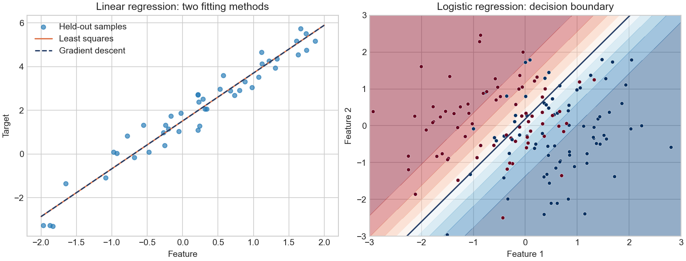

# Machine Learning from Scratch

**NumPy implementations of linear regression, logistic regression, k-nearest neighbors and an LDA projection with nearest-centroid classification.** Includes gradient descent, regularization and a manual cross-validation utility.

Selected coursework by **Daniel Carrasco Jurado**, studying Mathematical Engineering and Artificial Intelligence at ICAI, Comillas Pontifical University. The focus is translating mathematical models into code and checking their behavior against reference implementations.



## Implementations

| Module | Contents |
|---|---|
| [linear_regression.py](linear_regression.py) | Simple and multiple least-squares regression; R², RMSE and MAE |
| [gradient_descent.py](gradient_descent.py) | Linear regression using gradient descent or the normal equation; one-hot encoding |
| [logistic_regression.py](logistic_regression.py) | Binary classification, sigmoid, cross-entropy, L1, L2 and Elastic Net penalties |
| [knn.py](knn.py) | Minkowski distances, majority voting and neighbor-frequency probabilities |
| [lda.py](lda.py) | Within-class and between-class scatter matrices, discriminant projection and nearest-centroid prediction |
| [cross_validation.py](cross_validation.py) | Contiguous k-fold and leave-one-out splits; mean and standard deviation of scores |

Model fitting is implemented with NumPy. Scikit-learn is used for reference comparisons, example preparation and cross-validation tests, not as a replacement for the model implementations.

## Quick start

Tested with **Python 3.12**. From the repository directory:

```bash
python -m venv .venv
# Windows: .venv\Scripts\activate
# macOS / Linux: source .venv/bin/activate
python -m pip install -r requirements.txt
python -m pytest -q -m "not network"
python demo.py
```

The demo uses synthetic data with seed 42 and separate training and test sets. It saves `demo.png` and requires no dataset downloads.

| Demo | Held-out result |
|---|---:|
| Linear regression, least squares | RMSE = 0.5266 |
| Linear regression, gradient descent | RMSE = 0.5266 |
| Logistic regression | Accuracy = 0.7467; log-loss = 0.4982 |

These numbers illustrate behavior on the demo's synthetic data, not performance on a real-world benchmark. The figure covers the regression models; kNN and LDA have separate automated tests.

### kNN example

```python
import numpy as np
from knn import knn

model = knn()
model.fit(np.array([[0.], [1.], [2.]]), np.array(['low', 'high', 'high']), k=1)
print(model.predict(np.array([[1.8]])))
# ['high']
# predict_proba columns follow model.classes_ (sorted labels).
```

### LDA projection example

```python
import numpy as np
from lda import LinearDiscriminant

X = np.array([[-2., -1.], [-1., -1.], [-1., -2.],
              [1., 1.], [1., 2.], [2., 1.]])
y = np.array(['a', 'a', 'a', 'b', 'b', 'b'])
model = LinearDiscriminant(n_components=1)
projection = model.fit_transform(X, y)
print(projection.shape)  # (6, 1)
print(model.predict(X))  # ['a' 'a' 'a' 'b' 'b' 'b']
```

## Validation

The offline suite combines the original coursework tests with reference comparisons and regression tests for the fixes described in [PROVENANCE.md](PROVENANCE.md). It checks least squares, gradient-descent convergence, unregularized logistic probabilities, k-fold scores, kNN predictions and probabilities against scikit-learn, and LDA behavior under label renaming. LDA is tested as a projection plus nearest-centroid classifier, not for equivalence to scikit-learn's probabilistic LDA classifier.

GitHub Actions runs the offline tests and demo on Python 3.12. An additional optional test downloads Anscombe's quartet through Seaborn:

```bash
python -m pytest -q -m network
```

That test requires Internet access and is excluded from the offline suite. Tests cover specific cases, not every possible input.

## Scope and mathematical choices

- **Least squares:** explicitly inverts `X.T @ X`, requiring full column rank. Collinear inputs can fail or be numerically unstable; this retains the educational normal-equation implementation.
- **Gradient descent:** learning rate depends on feature scale. Initialization uses NumPy's global generator; call `np.random.seed(...)` for reproducible runs.
- **Logistic regression:** expects binary labels 0/1. `predict_proba` returns a vector of class-1 probabilities. The direct sigmoid may emit overflow warnings for extreme logits.
- **Regularization:** the original code multiplies penalties by `C / n`, so larger `C` means stronger regularization. Some inherited docstrings state the opposite. This is **not scikit-learn's inverse-C convention**; the original computation is preserved.
- **kNN:** brute-force neighbor search; numeric finite features and one-dimensional, consistently typed labels are expected. Probability columns use sorted `classes_`. Voting ties choose the smallest sorted label; distance ties retain training-row order. Use `1 <= k <= n_train`. The accompanying calibration helper uses bin centers and the ROC helper samples 11 thresholds; these are coarse teaching plots.
- **LDA:** the discriminant projection is followed by Euclidean nearest-centroid classification. Estimated class priors are stored but are not used in prediction. `predict_proba` returns normalized distance scores, **not calibrated Gaussian posterior probabilities**. The original inverse/pseudoinverse eigenproblem is retained and may be sensitive to ill-conditioned data. Inputs must contain at least two classes; dimensions are bounded by `min(n_features, n_classes - 1)`.
- **One-hot encoding:** a one-shot transformation, not a fitted encoder with a persistent vocabulary. Do not apply it separately to train and test and assume matching columns.
- **Cross-validation:** no shuffling or stratification. Requires NumPy arrays and `2 <= nFolds <= n_samples`, or `-1` for leave-one-out. It reuses the estimator, whose `fit` must reset state. Fit learned preprocessing inside each fold. The regression modules do not expose `.score()` and cannot be passed directly to this helper.

## Coursework and portfolio preparation

These implementations were completed in Machine Learning coursework using **ICAI-IMAT-ML** teaching templates and tests. Template interfaces and teaching tests are not claimed as wholly original library design.

The four initially published modules retain their original contents. kNN and LDA received targeted corrections to indexing, label handling and edge cases, without replacing their algorithms. Documentation, demo, configuration and additional tests were prepared with AI assistance. See [PROVENANCE.md](PROVENANCE.md) for the source mapping and change list.

This repository contains the selected executable core. Full classroom notebooks, datasets and historical outputs are not included.
